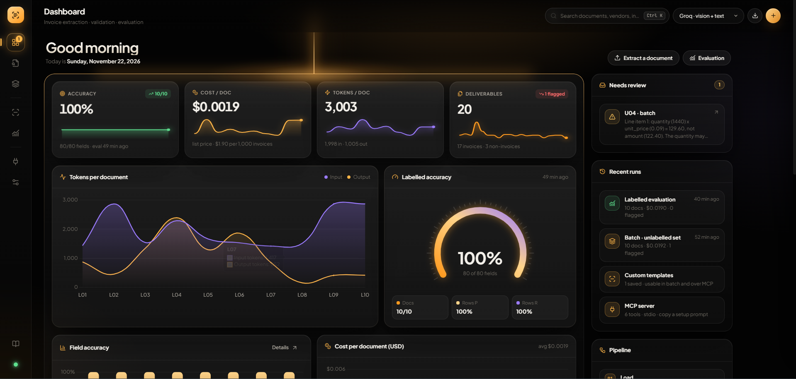

# Invoice Extraction Pipeline

**Live demo: [esmagicoagent.onrender.com](https://esmagicoagent.onrender.com/)**. It runs on Render's free tier, so the first load after 15 minutes idle takes about a minute to wake up. The login details are shared with the submission.



Reads a vendor invoice (clean PDF, phone scan or photo) and returns **validated JSON** in the assignment schema. It also handles documents that are not invoices, and corrupt files. It comes with a one-command evaluation, outputs for all 20 sample documents, a dashboard, and an MCP server so agents can use the pipeline as tools.

> **Results, approach, failure analysis and cost are in [REPORT.md](REPORT.md).** In short, on the 10 labelled documents with Groq (`qwen/qwen3.8-27b` vision + `openai/gpt-oss-120b` text):
> - **80/80 fields (100%)** on the final run, and 79/80 on two earlier runs;
> - **$0.0019 per document** at list price.
>
> The prompt was iterated while looking at the labelled set, so read the 100% as "no errors on 10 documents I partly tuned against". The rule-based baseline scores 92.5–93.8% on the same set but generalises poorly. REPORT.md has the details.

---

## Contents

1. [Assignment checklist](#1-assignment-checklist)
2. [Setup (fresh clone)](#2-setup-fresh-clone)
3. [Run it](#3-run-it)
4. [How it works](#4-how-it-works)
5. [Validation and bad inputs](#5-validation-and-bad-inputs)
6. [Evaluation harness and matching rules](#6-evaluation-harness-and-matching-rules)
7. [Dashboard](#7-dashboard)
8. [MCP server (agents)](#8-mcp-server-agents)
9. [Configuration](#9-configuration)
10. [Project layout](#10-project-layout)
11. [Privacy, security and limits](#11-privacy-security-and-limits)
12. [Deploy (free tier)](#12-deploy-free-tier)

---

## 1. Assignment checklist

| Requirement | Where |
|---|---|
| LLM-based extractor, PDF/image → schema JSON, with a reason for the approach | [pipeline/extractor.py](pipeline/extractor.py), [config/prompts.py](config/prompts.py), [REPORT.md §1](REPORT.md#1-approach) |
| CLI: `python extract.py invoice.pdf > out.json` | `python scripts/extract.py invoice.pdf > out.json` |
| API | FastAPI: `uvicorn api.main:app` → `POST /extract`, docs at `/docs` |
| Schema validation (Pydantic) + `sum(items) + tax ≈ total` + retry/flag | [pipeline/validator.py](pipeline/validator.py), [§5](#5-validation-and-bad-inputs) |
| Non-invoices + one more bad-input case (**chosen: corrupt/unreadable files**) | [§5](#5-validation-and-bad-inputs), [REPORT.md §6](REPORT.md#6-bad-inputs) |
| One-command eval on the 10 labelled docs, field-by-field table, stated matching rules | `python scripts/eval.py`, [§6](#6-evaluation-harness-and-matching-rules) |
| JSON for all 20 documents | [outputs/](outputs/) (`L01`–`L10`, `U01`–`U10`) |
| Report: approach, what did not work, field accuracy, failure analysis, cost per document | [REPORT.md](REPORT.md) and the generated [reports/accuracy_table.md](reports/accuracy_table.md) |
| Overfitting disclosure | [REPORT.md › Overfitting disclosure](REPORT.md#overfitting-disclosure) |
| No API keys committed; `.env.example` provided | `.env` is git-ignored; [.env.example](.env.example) |
| Bonus: `needs_review` checked against the data | [REPORT.md §5](REPORT.md#5-bonus-is-needs_review-checked-against-the-data), Evaluation page of the dashboard |
| Bonus: upload a document and see the fields next to it | Dashboard → Workspace ([§7](#7-dashboard)) |

---

## 2. Setup (fresh clone)

Requirements: **Python 3.10+** (tested on 3.12, Windows and Linux). No system binaries are needed: OCR uses `rapidocr-onnxruntime` from pip, and Tesseract is only an optional fallback.

```bash
git clone <repo-url> && cd EsMagicoAgent
python -m venv .venv
# Windows: .venv\Scripts\activate      macOS/Linux: source .venv/bin/activate
pip install -r requirements.txt

cp .env.example .env        # Windows: copy .env.example .env
# then put at least one Groq key in .env:  GROQ_API_KEY_1=gsk_...   (free at https://console.groq.com)
```

To check that everything works without any key, run `python -m pytest tests -q` (32 tests, no network calls) and `python scripts/eval.py --mode no_ai --no-save` (the rule-based baseline).

If you pick a cloud backend without a key, you get a clear error. It never silently falls back to the rule engine, so a baseline run can't be mistaken for an LLM run.

---

## 3. Run it

| Task | Command |
|---|---|
| Extract one document (JSON to stdout) | `python scripts/extract.py invoice.pdf > out.json` |
| …with review flag, reasons, tokens and cost | `python scripts/extract.py invoice.pdf --meta` |
| …fail the shell step if it needs review | `python scripts/extract.py invoice.pdf --strict` (exit 3) |
| **Evaluate on the 10 labelled docs** | `python scripts/eval.py` (default backend from `AI_MODE`) |
| Rule-based baseline, without touching outputs/reports | `python scripts/eval.py --mode no_ai --no-save` |
| Batch a folder (writes `outputs/<name>.json`) | `python scripts/batch.py "Es Magico - AI Intern Assignment - Sample Pack/unlabelled"` |
| Dashboard | `python scripts/serve_dashboard.py`, then open http://localhost:8000 |
| REST API only | `uvicorn api.main:app --port 8000` (OpenAPI docs at `/docs`) |
| MCP server (stdio) | `python scripts/mcp_server.py` ([§8](#8-mcp-server-agents)) |
| Tests | `python -m pytest tests -q` |

Common flags:
- `--mode groq|openai|gemini|local|no_ai` picks the backend.
- `--cache/--no-cache` controls reuse of results keyed by file hash + model + prompt version + image-pipeline version.
- `--workers N` sets how many documents run in parallel.

Exit codes for `extract.py`: `0` OK · `1` unreadable or unsupported file · `2` backend not configured · `3` needs review (only with `--strict`).

Example output (U08, Dutch invoice with European number format):

```json
{
  "is_invoice": true,
  "vendor": "Sakura Tea Traders B.V.",
  "invoice_number": "2026/0314",
  "invoice_date": "2026-03-14",
  "currency": "EUR",
  "line_items": [{ "description": "Sencha Premium, 1 kg bag", "quantity": 8.0, "amount": 340.0 }, "..."],
  "tax_total": 107.25,
  "total": 1136.25
}
```

---

## 4. How it works

```
file ─► load + bad-input checks ─────────────────────────────────────► typed error (never sent to a model)
          ├─ digital PDF (text layer) ─► layout text "cell | cell" ─► text LLM   (gpt-oss-120b, JSON mode)
          └─ scan / photo ─► render 200 dpi ─► auto-upright ─► image ─► vision LLM (qwen3.8-27b, JSON mode)
                                                      │
               normalise numbers / dates / currency (1.136,25 → 1136.25; 07/02/2026 → ISO by locale)
                                                      │
          validate: schema · required fields · Σ items + tax = total · qty × unit price · issue vs due date
                                                      │ errors?
                  corrective retry quoting the exact errors (max 2) ─► keep the best attempt
                                                      │
                     JSON + needs_review + review_reasons + tokens + USD cost
```

- **Why this routing:** a digital PDF's text layer has exact characters and costs about 3× fewer tokens than an image, so it goes to a strong text model. Scans and photos go to a vision model, which reads layout and handwriting-quality print far better than OCR followed by an LLM. Model choice and alternatives are discussed in [REPORT.md §1](REPORT.md#model-choice-and-why).
- **Prompt:** the sample pack's labelling conventions, restated as rules:
  - vendor = the seller;
  - date = issue date, not due date;
  - `quantity = null` on rows without a quantity;
  - discounts are negative line items;
  - `tax_total` = the sum of every tax line;
  - locale-aware numbers and dates.

  The model also returns two helper fields that are dropped from the output: `unit_price` (checks quantity × price = amount) and `due_date` (catches misread years on scans).
- **Rate limits:** a client-side token bucket keeps parallel workers under Groq's tokens-per-minute limit, and a 429 waits for the server's `retry-after`.

---

## 5. Validation and bad inputs

**Checks** ([pipeline/validator.py](pipeline/validator.py)):
- Pydantic schema; a non-invoice must have every other field `null`.
- Required invoice fields are present.
- `|Σ line amounts + tax − total| ≤ max(0.05, 0.01 × rows)`.
- Quantity × unit price = amount.
- The issue date isn't after the due date or more than 120 days before it.
- No negative tax, and quantity ≠ amount.

**When a check fails:** the model gets the exact error messages and retries (up to 2 times), and the best attempt is kept. If anything still fails, the result is returned with **`needs_review: true`** and `review_reasons`. Bad data is never passed on silently. Whether the flag actually catches the errors is measured in [REPORT.md §5](REPORT.md#5-bonus-is-needs_review-checked-against-the-data).

| Bad input | Behaviour |
|---|---|
| Not an invoice (PO, bank statement, letter) | `is_invoice: false`, all other fields `null` (L08, U06, U10) |
| **Chosen case: corrupt or unreadable file** (0 bytes, truncated or garbage PDF, broken image, password-protected PDF, unsupported type) | Caught at load time and never sent to a model. Returns `{"error": "...", "error_type": "corrupt_file" \| "unsupported", "needs_review": true}`; the CLI exits 1 and a batch carries on with the other files |
| API trouble (429, timeout, 5xx, quota, bad key) | Backoff and retry with rate-limit pacing; finally `error_type: "backend_error"`. Never a silent backend switch |
| Model returns broken JSON | One repair round-trip, then `error_type: "unparseable"` |
| Sideways scan | Auto-rotated before extraction |

---

## 6. Evaluation harness and matching rules

`python scripts/eval.py` runs the extractor on `L01`–`L10` in parallel and prints:
- a field-level accuracy table and a per-document matrix;
- errors grouped by cause (tags computed from the data);
- the `needs_review` precision/recall check;
- tokens and cost.

It writes [reports/accuracy_table.md](reports/accuracy_table.md) and `reports/eval_results.json`. The rules are implemented in [eval/metrics.py](eval/metrics.py):

| Field | Rule |
|---|---|
| `is_invoice` | exact boolean |
| `vendor` | case/punctuation-insensitive; legal suffixes canonicalised (Pvt Ltd = Private Limited, Ltd = Limited, Co = Company…); equal, or `fuzz.ratio ≥ 90`. No subset matching ("Acme" ≠ "Acme Holdings Global") |
| `invoice_number` | exact after trimming whitespace and upper-casing |
| `invoice_date` | exact ISO `YYYY-MM-DD` |
| `currency` | exact ISO-4217 code |
| `tax_total`, `total` | numeric, `|pred − gt| ≤ 0.01` after parsing (`"1,200.00"` = `1200`) |
| `line_items` | strict: same number of rows, in order; description fuzz ≥ 80, quantity equal or both `null`, amount within 0.01. Row-level precision/recall is reported separately |
| both `null` | match (non-invoices) |

---

## 7. Dashboard

`python scripts/serve_dashboard.py` → http://localhost:8000. Plain HTML/JS modules ([dashboard/static/](dashboard/static/)) on top of the same REST API, with no build step. Press <kbd>Ctrl</kbd>+<kbd>K</kbd> to jump to any document by id, vendor or invoice number. Animations follow the OS "reduce motion" setting.

| Page | What it does |
|---|---|
| **Overview** | Headline accuracy, cost per document, review queue (documents flagged in the last runs, with reasons), field-accuracy chart, every deliverable output with a Σ check |
| **Workspace** | Pick a sample or upload/drag a file; the document preview (zoom, pages) sits next to the extracted fields, line items, a ground-truth comparison (labelled docs) and the JSON. Shows the validation banner, tokens, cost and latency |
| **Batch processing** | Drop many files and choose the **invoice schema or any saved template**. Runs as a background job with live progress; results can be filtered (needs review / errors / valid); click any row for a **preview drawer** with the document and its fields; export to Excel or a JSON zip |
| **Template studio** | Define custom fields for non-invoice documents (hall tickets, waybills…): auto-discover fields with the LLM, edit keys, types and required flags, save/update/delete, test, then **Use in batch** |
| **Evaluation** | Run the labelled eval (asks before spending API calls), field chart, per-document matrix with a prediction-vs-truth drawer, error groups, `needs_review` confusion matrix, cost method |
| **MCP & agents** | **Copy setup prompt** button: a ready-made instruction to paste into any IDE agent (Claude Code, Cursor, Windsurf, VS Code…) so it installs and checks the server itself. Also copy-paste config for Claude Code, Claude Desktop, Cursor, VS Code and the MCP Inspector (with this machine's paths), the tool list, and a **playground** that calls each tool with a generated form |
| **Settings** | Default backend, provider keys with live connection tests, PII shield toggle with a redaction tester |

Results produced in the dashboard are written to `outputs/dashboard/`. The deliverable `outputs/*.json` files are only written by the CLI, so trying another backend in the UI can't overwrite them.

---

## 8. MCP server (agents)

[scripts/mcp_server.py](scripts/mcp_server.py) exposes the pipeline over the Model Context Protocol (official Python SDK, stdio). The tools are implemented once in [pipeline/tools.py](pipeline/tools.py), and the dashboard playground calls the same functions.

| Tool | Purpose |
|---|---|
| `list_documents` | sample and uploaded documents with their `doc_id` |
| `extract_invoice` | schema JSON + `needs_review`, reasons, tokens, cost (`doc_id`, or an absolute `path` over MCP) |
| `validate_invoice_json` | run the schema + arithmetic checks on JSON produced elsewhere |
| `list_templates` / `extract_with_template` | custom-field extraction for any document type |
| `get_latest_evaluation` | accuracy per field, cost per document, review-flag check |

```bash
claude mcp add invoice-pipeline -- python /abs/path/to/scripts/mcp_server.py     # Claude Code
python scripts/mcp_server.py --print-config                                       # Claude Desktop / Cursor block
npx @modelcontextprotocol/inspector python scripts/mcp_server.py                  # try it interactively
```

The quickest setup is the **Copy setup prompt** button on the dashboard's MCP page. Paste the prompt into your IDE's agent chat, and the agent adds the server to its own config (keeping your other servers), starts it, lists the tools and runs a no-cost smoke test.

Over HTTP (`POST /api/mcp/call`) only `doc_id`s are accepted, never file paths.

---

## 9. Configuration

All settings live in `.env` (see [.env.example](.env.example)); defaults are in [config/settings.py](config/settings.py).

| Variable | Default | Meaning |
|---|---|---|
| `AI_MODE` | `groq` | `groq` · `openai` · `gemini` · `local` · `no_ai` |
| `GROQ_API_KEY_1..10` | – | rotated; free-tier limits are per organisation |
| `GROQ_VISION_MODEL` / `GROQ_TEXT_MODEL` | `qwen/qwen3.8-27b` / `openai/gpt-oss-120b` | scans / digital PDFs |
| `ROUTE_DIGITAL_TO_TEXT` | `true` | send PDFs with a text layer to the text model |
| `MAX_RETRIES` | `2` | corrective retries after a failed validation |
| `ARITHMETIC_TOLERANCE` | `0.05` | Σ check tolerance (currency units) |
| `RENDER_DPI` / `MAX_IMAGE_SIDE` / `MAX_PAGES` | `200` / `1800` / `5` | image input |
| `MAX_WORKERS` | `4` | documents in parallel |
| `CACHE_ENABLED` | `true` | result cache in `.cache/` |
| `PII_SHIELD_ENABLED` | `false` | mask bank/card/ID numbers in text sent to cloud models |
| `OPENAI_*`, `GEMINI_*`, `LOCAL_LLM_*` | – | alternative backends (OpenAI-compatible APIs, Ollama/LM Studio) |

---

## 10. Project layout

```
config/            settings.py (env), prompts.py (extraction + retry prompts, PROMPT_VERSION)
pipeline/          document_loader · ocr_engine (auto-upright, OCR fallback) · extractor (retry loop)
                   normalizer · validator · models (schema) · cost_tracker · cache · batch_runner
                   template_engine (custom templates) · pii_shield · tools (agent tools) · output_writer
ai_backends/       base · groq_backend (key rotation, token bucket) · openai_backend (OpenAI/Gemini/local)
                   no_ai (rule-based baseline) · router (no silent fallback)
eval/              metrics (matching rules, error tags) · harness · report
api/               FastAPI app + routes (extract, evaluation, dashboard, MCP playground)
dashboard/static/  index.html · css/app.css · js/{core,overview,workspace,batch,templates,evaluation,mcp,settings}.js
scripts/           extract.py · eval.py · batch.py · serve_dashboard.py · mcp_server.py
outputs/           deliverable JSON for all 20 documents
reports/           accuracy_table.md, eval/batch run metadata (tokens, cost, review flags)
tests/             32 offline tests (validator, metrics, extractor retry/bad inputs, tools)
docs/              dashboard screenshot
Dockerfile         container for hosting (Render, Hugging Face Spaces, any VM); render.yaml = Render blueprint
REPORT.md          approach, accuracy, failure analysis, cost, needs_review check, overfitting disclosure
```

---

## 11. Privacy, security and limits

- **Keys:** `.env` is git-ignored and never committed. The dashboard's settings endpoints only accept changes from the machine running the server.
- **Sample documents** are confidential to this assignment. Keep this repository **private** and share it only with the reviewers.
- **PII shield** masks values that the 8 output fields never need: IBANs, labelled bank accounts, Luhn-valid cards, emails, phone numbers, SSN, PAN. It only masks the **text** sent to a cloud model; page images sent to a vision model are not redacted. Use `AI_MODE=local` when documents must never leave the machine.
- **Uploads** get sanitised, unique file names; there are a 25 MB limit and a file-type whitelist.
- **Known limits:**
  - 10 labelled documents is a small sample;
  - only the first 5 pages go to the vision model (truncation is flagged);
  - pages scanned upside down (180°) are not auto-corrected;
  - list prices come from Groq's `/models` endpoint at run time.

---

## 12. Deploy (free tier)

The app is one long-running FastAPI process: background batch and eval jobs are held in memory, uploads are written to disk, and the OCR models load once. That rules out serverless platforms such as **Vercel** or Netlify Functions:
- the Python bundle limit is 250 MB, and PyMuPDF + ONNX OCR + pandas exceed it;
- requests time out at 10–60 s, while an eval run takes 2–3 minutes;
- there is no shared memory between invocations, so job polling breaks;
- the filesystem is read-only.

A container host is the right fit. The repository ships a [Dockerfile](Dockerfile) and a Render blueprint ([render.yaml](render.yaml)).

> **Set `APP_PASSWORD` on any public deployment.** The sample documents are confidential, and every extraction spends your API quota. With `APP_PASSWORD` set, the whole app (dashboard and API) requires HTTP basic auth with user `admin`, or `APP_USER` if you set it; `/health` stays open for health checks. Keys come from the platform's secret settings, never from the repo, and the dashboard's settings page is read-only when not accessed from localhost.

### Option A: Render (recommended; free, deploys from GitHub)

1. Push this repo to GitHub (private is fine: Render asks for access).
2. On [render.com](https://render.com): **New → Blueprint**, then pick the repo. Render reads `render.yaml`.
3. When prompted, enter `GROQ_API_KEY_1` and choose an `APP_PASSWORD`. **Apply.**
4. The first build takes about 5 minutes. Open `https://<service>.onrender.com`, log in as `admin` / your password, and the dashboard loads with the committed outputs and eval.

The free instance has 512 MB RAM and sleeps after 15 minutes idle, so the first request after that takes about a minute. The container uses about 415 MB once the OCR models load (measured locally), which fits but leaves little headroom; Option B has far more memory.

### Option B: Hugging Face Spaces (free, 16 GB RAM, does not sleep while in use)

1. Create a Space: **SDK = Docker**, visibility **Private**.
2. Under Settings → Variables and secrets, add the secrets `GROQ_API_KEY_1` and `APP_PASSWORD`, and the variable `PORT=7860`.
3. Push this repo to the Space's git remote. Keep the YAML header that Hugging Face generated at the top of the Space's `README.md`, with `sdk: docker` and `app_port: 7860`.

### Any VM or local Docker

```bash
docker build -t invoice-pipeline .
docker run -p 8000:8000 --env-file .env -e APP_PASSWORD=change-me invoice-pipeline
# → http://localhost:8000  (user: admin)
```

### What persists

Uploads, dashboard results, saved templates and the result cache live on the container's disk. On free plans that disk is reset on every redeploy and restart. The deliverables (`outputs/`, `reports/`) are baked into the image from the repo.

---

## Submission checklist

- [x] Code, README with fresh-clone setup, `.env.example`, and no keys in git history
- [x] CLI (`scripts/extract.py`) and API (`api/main.py`)
- [x] One-command eval (`python scripts/eval.py`) with stated matching rules
- [x] `outputs/` with JSON for all 20 documents
- [x] [REPORT.md](REPORT.md): approach, what did not work, accuracy table, failure analysis, cost per document, overfitting disclosure
- [x] Bonus: `needs_review` checked against the data; upload-and-view frontend
- [ ] Keep the GitHub repo **private** (the sample documents are confidential) and add the reviewers as collaborators
